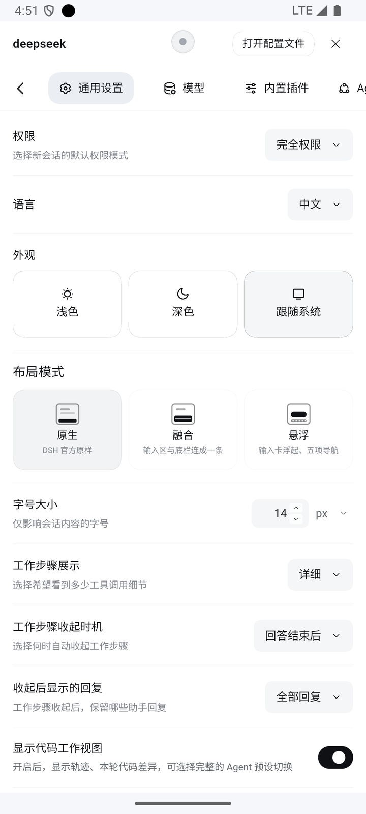

# dsh-mobile-layout

> 中文文档 ｜ [English version](README.en.md)

[](https://github.com/XiaoPb/dsh-mobile-layout/actions/workflows/ci.yml)
[](https://github.com/XiaoPb/dsh-mobile-layout/actions/workflows/release.yml)
[](https://www.npmjs.com/package/@xiaopb/dsh-mobile-layout)

**DSH 手机 / 平板触控布局插件（v0.4.8）**

文档：[架构文档](docs/architecture.md) ｜ [技术说明](docs/technical-notes.md) ｜ [预设方案 / 进度](docs/preset2-progress.md) ｜ [更新日志](CHANGELOG.md) ｜ [English](README.en.md)

一个 Cordis 插件，让 DSH Web 客户端在**手机竖屏**下变成单手可操作的触控布局——**不修改官方内核、不替换官方布局插件**。手机竖屏外，横屏 / 桌面保持官方布局像素级不变；**平板宽屏（0.4.8 起）只额外注入一组侧栏滑动手势**，官方布局同样保持原样。

---

## 核心功能

- **左侧栏 → 抽屉**：屏幕左侧约 60% 区域（QQ 式，中间偏左起手）右滑打开，**跟手拖拽 + 松手吸附**（甩动优先），遮罩或左滑关闭；入口只有手势、无按键（不遮挡子页面返回键），手势常驻 window 捕获阶段、任何插件页面都可用；只在真正换页时自动收起（点空白、搜索、账号菜单等保持展开）。
- **底部常驻操作条**：新建 / 会话 / 文件 / 图片 / 插件 / 更多，紧贴输入区上沿。
- **加号面板**：与软键盘**揭开 / 覆盖式切换**（面板内容自适应高度；键盘上滑盖住面板、下滑揭开面板，输入行位置由视口跳变换算保持，无收展交叉）；开合带滑动动画（减动效宿主自动跳过）；4 列 × 2 行宫格，超过 8 项横向分页；图标**按功能类型配色**（蓝 / 橙 / 紫 / 绿 12 档柔和色，同类型同色、同屏不撞色、新增功能按别名哈希自动落位）。
- **会话面板 / 插件面板**：按工作区分组、吸顶标题、相对时间，最多占屏高 64%；顶部把手**下拉即关**，视觉对齐引擎 v1.4.57 官方弹层（28px 大圆角、抬升面、大标题、胶囊主按钮）。
- **输入区融合底部面板**：去圆角 / 边框 / 阴影、全宽同表面、1px 分界；空态收紧；权限与模型短名 chip 留在输入行（**「完全访问」恒标红**，中英文都认）。
- **设置页全屏**：品牌行 + 可横滑页签 + 返回键；内容区左右横滑切换页签，仅最左页签右滑跟手退出面板（其余方向让路换页，边界判定与翻页共享）。
- **选择器重造型**：模型 / 权限二级菜单改为贴底列表，选中态用主题蓝；空态下打开选择器不弹软键盘（搜索框自动落焦守卫，真点搜索框仍可正常输入）。
- **浮层互斥 + 历史栈**：抽屉 / 底部表 / 加号面板互斥，按层序逐层关闭；加号面板与输入法双向互斥（开面板先收键盘；面板开着点输入框先收面板、键盘等面板收完再拉起）。
- **三套布局预设**：**原生**（官方原样）/ **融合**（输入区与底栏连成一条）/ **悬浮**（手机应用形态），设置页一键切换，见下节。
- **平板宽屏侧栏手势**（0.4.8 起）：平板 / 宽屏下侧栏是常驻列、收起后变窄条 rail——**视口左半边任意位置左滑收起、右滑展开**（阈值触发官方 toggle 与过渡动画，不做跟手）；官方模态弹窗在屏时手势自动让路，右半边起手交还内容自身。与手机抽屉手势共用一套引擎，桌面宿主不启用。
- **中英文跟随**：插件自绘 UI（布局模式卡片、底栏、面板文案）随官方语言**实时刷新**，切语言不必重启；语言服务缺席时退回 `<html lang>` / 系统语言。
- **无障碍 & 动效降级**：`aria-modal`、焦点进出、尊重系统「减少动态效果」。

### 三套布局预设（原生 / 融合 / 悬浮）

三套布局叫**原生 / 融合 / 悬浮**：原生 = DSH 官方原样；融合 = 输入区与底栏连成一整条（v1）；悬浮 = 输入卡浮起 + 五项导航（v2）。切换入口只有一处：**设置 → 通用设置 → 外观下面**的「布局模式」，原生 / 融合 / 悬浮三张卡片（各带迷你线框缩略图），其它页签（模型 / 内置插件）不出现。切换即时生效、三档双向往返不残留，且**插件自带的配置页**（如桌宠配置、插件市场）同样被接管。

- **原生**：整体交还官方布局；手机上设置页与其余两预设一致为**全屏**（0.4.7 起，品牌行 + 可横滑页签 + 返回键），平板 / 桌面保持官方两列弹窗。**唯一例外**是输入行「附件」入口：一枚回形针按钮，点开就近弹出「选择图片 / 选择文件」，省掉「点 ⊕ → 在指令列表里找上传」那一步。App 内（手机 / 平板、横竖屏、全屏 / 小窗）都出现，桌面端不出现。
- **融合**：输入区与底栏连成一整条；空态虚线输入卡左右留白对称（此前左侧贴边、右侧多 7px，是官方滚动容器的经典滚动条沟槽所致）。

悬浮预设是**手机应用形态**：底部五项导航当换页器，输入卡悬浮，加号面板改成一 / 二级菜单。

- **五项导航**：会话 / 自动化任务 / 插件 / 工作台 / 设置，图标直接用 DSH 自带符号，当前页那枚用官方蓝（`--dsw-alias-state-business-primary`）上色。会话键是「回首页」——在插件 / 设置 / 工作台页按它回到会话页，已经在会话页才弹会话抽屉；插件 / 自动化任务 / 设置是**页面**不是弹层，导航常驻可继续换页（在该页再点同一个键 = 返回会话）。
- **工作台**：直接开关官方右侧面板（`sidebarRight.toggleExpanded`），手机宽度下官方自动全屏，面板底部给导航让位；**横滑一下即退出**，从插件 / 自动化任务页点它则先收起页面再打开。
- **加号面板（自绘）**：一级页 = 附件三块（**图片 / 相机 / 文件**）+ 各官方分组一行；点分组进二级页，条目按「标题 + 官方描述」列成菜单。数据与动作仍来自官方节点（读它的选项、派发它的 `mousedown`），不复制命令语义。
- **覆盖式抽屉**：加号 / 模型 / 权限 / 工作区选择都从底部盖上来，不把正文推上去；会话抽屉固定占屏高 55%，条目少时底部留白。
- **透明底栏**：底栏不铺底色、不画分割线，输入卡的软阴影可以直接落到导航这一行，不会被切出一条硬边。
- **引擎状态条让位**：宿主自己的「引擎已就绪」条是原生视图（DOM 里没有、CSS 关不掉、量视口也不变），用 `--dshm-engine-bar`（默认 56px）给面板让出顶部；习惯先点箭头收起它的话改成 `0px` 即可。

## 优势

| | |
|---|---|
| **零侵入** | 全部样式受 `data-dshm-mode="mobile"` 作用域保护，卸载或锚点失败即回退官方布局。 |
| **单文件产物** | `lib/client.js` 即发布物，无构建、无运行时依赖。 |
| **形态保守** | 识别三种宿主（Android 壳 / 桌面 Electron / 浏览器）；桌面端 DeepSeek Harness **永不激活**（任何窗口尺寸官方布局不变）。布局改造只作用于手机竖屏；平板宽屏（0.4.8 起）仅注入侧栏手势、官方布局像素级不变。 |
| **触控优先** | 44px 触控目标、滑动手势、单手可达；手机抽屉跟手、平板侧栏阈值触发。 |
| **稳定配色** | 哈希落位，新增功能图标免改代码自动配色。 |
| **自适应几何** | 留白 / 圆角 / 高度全部走 CSS 变量（`clamp()` + 安全区），不写死 px，跨机型自动缩放。 |
| **硬编码守卫** | CI 扫描注入样式中的固定 px，**新增一处即失败**，存量进 baseline 渐进收紧。 |
| **真机验收** | MuMu 模拟器（720×1280）、手机 / 平板两台 AVD（CDP 真实触摸回归）与 Redmi K70 真机复核，CI 单测 **222** 项全绿。 |

---

## 多机型自适应

几何量不写死：全部走 `html[data-dshm-form="phone"]` 作用域下的 CSS 变量，小屏不至于挤、大屏不至于留两条大空边，并叠加 `env(safe-area-inset-*)` 兼容挖孔屏 / 手势条。可在自己的用户样式里覆盖任一变量：

| 变量 | 默认值 | 作用 |
|---|---|---|
| `--dshm-settings-gutter` | `clamp(12px, 3.4vw, 20px)` | 原生设置悬浮窗左右留白（0.4.7 起手机统一全屏，悬浮窗样式仅回滚 `SETTINGS_UNIFIED_FULLSCREEN` 后生效，下两条同） |
| `--dshm-settings-vpad` | `clamp(--dshm-settings-vpad-min 24px, 10vh, --dshm-settings-vpad-max 120px)` | 原生设置悬浮窗上下留白；小屏保底、大屏封顶 |
| `--dshm-settings-maxw` | `480px` | 原生设置悬浮窗最大宽度 |
| `--dshm-classic-gutter` | `clamp(12px, 3.4vw, 20px)` | 融合空态虚线输入卡左右留白 |
| `--dshm-classic-radius` | `16px` | 融合空态输入卡圆角 |
| `--dshm-v2-gutter` | `8px` | 悬浮输入卡四周留白 |
| `--dshm-v2-radius` | `20px` | 悬浮输入卡圆角（虚线描边跟随，不再错开） |
| `--dshm-v2-nav` | `56px` | 悬浮五项导航高度 |
| `--dshm-engine-bar` | `56px` | 宿主「引擎已就绪」状态条让位高度（习惯先收起就设 `0px`） |
| `--dshm-viewtabs-extra` | `360px` | 「对话 / 轨迹 / 编辑器」页签行的不可见横向余量。官方按每页签 120px 估宽（实测间距仅 58px），手机宽度下会把第三、四个视图提前收进「⋯」；这段余量让官方算出足够名额。设 `0` 即回到官方行为 |

---

## 系统返回（手机形态）

手机形态接管 Android 的返回键 / 返回手势：一次只退一层，绝不重载页面。

| 当前画面 | 按一次返回 |
|---|---|
| 加号面板子层 / 抽屉 / 底部表 / 头部菜单 | 收起该浮层 |
| 设置页（覆盖层） | 收起设置，露出下面的页面 |
| 插件页 / 自动化任务 / SSH 工作区等**整页界面** | 回会话页 |
| 会话页（起始页） | 首次轻提示「再按一次退出」，2 秒内再按才退出 |

- 页面态只认宿主通用字段 `panelInfo.activePanelId`，**其它插件经 `main` 槽位注册的页面同样一次返回回会话页**，不需要本插件认识它的 id；关闭走通用的 `layout.selectPanel(null)`。
- 返回过程不重新加载、不重新请求、不丢输入草稿。
- 其它插件可以把返回接管权拿回去：

```js
const off = window.__dshmBack.register({
  id: 'my-plugin.detail',
  priority: 10,                                  // 越大越先问；同级时后注册的先问
  kind: 'page',                                  // 'page' | 'overlay'，仅用于诊断
  isActive: () => detailOpen,                    // 我现在是否在最上面
  close: () => { closeDetail(); return true; },  // true = 本次返回已被消费
});
// 卸载时调用 off()
```

- 不想接契约的插件也可以纯声明：给浮层根节点加 `data-dshm-back-layer` 就会被识别并尝试关闭；加 `data-dshm-ignore-back` 则排除。
- 桌面形态（原生预设 / 桌面端）完全不碰浏览器历史，行为与官方一致。
- 回滚：`localStorage['dshm-back-stack'] = 'off'` 退回 v0.4.4 的行为。

### 旧版 App（无返回桥）

不需要升级 App 也能拿到防误退，插件会自己兜底：

| 环境 | 会话页按返回 |
|---|---|
| 配套的新壳（有 `DshAndroidBack` 桥） | 原生 Toast「再按一次退出」，2 秒内再按才退出 |
| **旧壳 / 第三方壳（无桥）** | 插件自绘提示条，同样 2 秒内再按才退出（第二次由壳原有的 `finish()` 完成） |
| 纯浏览器 / 桌面端 | 不接管，保持浏览器原生行为 |

机制：旧壳只认 `canGoBack()`，所以插件在栈底压一条哨兵条目让历史永远「有得退」；退到底时弹提示，**提示期间故意不压回**，`canGoBack()` 保持 `false`，第二次返回就落到壳的 `finish()` 上；超过 2 秒自动重压哨兵，避免把用户困在页面里。哨兵不计入「可退层数」，换到带桥的新壳或离开手机形态时会自动退掉。

## 工作原理


## 界面截图

> v0.4.0 在 MuMu 模拟器（物理 720×1280，CSS 视口 400×684）的整机实拍，浅色主题。每个模式的全部页面见独立文档：[原生](docs/preset-default.md) ｜ [融合](docs/preset-classic.md) ｜ [悬浮](docs/preset-v2.md)。

<table>
  <tr>
    <th align="center"><a href="docs/preset-default.md">原生（官方原样）</a></th>
    <th align="center"><a href="docs/preset-classic.md">融合（通栏 v1）</a></th>
    <th align="center"><a href="docs/preset-v2.md">悬浮（v2）</a></th>
  </tr>
  <tr>
    <td align="center"><br><sub>主界面</sub></td>
    <td align="center"><br><sub>主界面</sub></td>
    <td align="center"><br><sub>主界面</sub></td>
  </tr>
  <tr>
    <td align="center"><br><sub>设置页（0.4.7 起全屏）</sub></td>
    <td align="center"><br><sub>设置全屏 · 布局模式</sub></td>
    <td align="center"><br><sub>设置全屏 · 布局模式</sub></td>
  </tr>
</table>

早期版本（v0.1.6，v1 单栏布局）的截图存档已移到独立文档：[docs/archive-v0.1.6.md](docs/archive-v0.1.6.md)。

---

## 版本适配与 DSH 引擎兼容性

> 表中「DSH 版本」指宿主内核 / 官方 UI 布局包 `@deepseek-ai/dsh-client-ui-layout` 的版本，**不是** Android App 的 `versionName`。完整证据与声明口径见 [技术说明 §3.15](docs/technical-notes.md)。

### 插件版本 → 适配的 DSH 版本

| 插件版本 | `engines.dsh` 声明 | `dshReleases` 逐版本登记 | 已验证的 DSH 版本 | 对 `0.2.2-rc.1` | 说明 |
|---|---|---|---|---|---|
| **0.4.8**（当前） | `>=0.2.1-rc.2` | `0.2.1-rc.2`、`0.2.1-rc.5`、`0.2.2-rc.1` 均 `compatible`（沿用 0.4.7） | `0.2.1-rc.2` / `0.2.1-rc.5` / `0.2.2-rc.1` | ✅ 兼容 | 0.4.7 的全部适配 + 0.2.2-rc.1 二轮修复 + 平板宽屏侧栏手势；新装 / 升级请直接用 0.4.8 |
| 0.4.7 | `>=0.2.1-rc.2` | `0.2.1-rc.2`、`0.2.1-rc.5`、`0.2.2-rc.1` 均 `compatible` | `0.2.1-rc.2` / `0.2.1-rc.5` / `0.2.2-rc.1` | ✅ **首个适配版本** | 按官方 `data-shortcut-modal` 正向契约 + `settings.general.item` slot 接入；三预设统一全屏设置页；未知引擎自动 `safe` 降级 |
| 0.4.4 – 0.4.6 | `>=0.2.1-rc.2` | `0.2.1-rc.2`、`0.2.1-rc.5` 为 `compatible` | `0.2.1-rc.2` / `0.2.1-rc.5` | ❌ 不兼容（未登记 = `unknown`） | 在 0.2.2-rc.1 上实测：布局模式选择器失效、原生预设设置页变悬浮小窗且标题/页签/内容裁切、设置页关不掉；请升级到 0.4.8 |
| 0.1.6 – 0.4.3 | `>=0.2.1-rc.2` | 无（0.4.4 起才引入该字段） | `0.2.1-rc.2` / `0.2.1-rc.5`（0.4.4 沿用的历史实测结论） | ⚠️ 未验证 | 只有 `engines.dsh` 范围声明，没有逐版本登记；不建议在新引擎上使用 |

### DSH 版本 → 建议的插件版本（反向速查）

| DSH / 官方 UI 布局包版本 | 宿主 App | 建议插件版本 | 结论 |
|---|---|---|---|
| `0.2.2-rc.1` | Android App 1.5.0 · BUILD `2026.11.06-4566c0be` | **≥ 0.4.8** | ✅ 已适配并在两台 AVD + Redmi K70 验收；0.4.6 及以下不要用 |
| `0.2.1-rc.5` | —（未记录对应关系） | 0.4.8（也可用 0.4.4 – 0.4.7） | ✅ `compatible` |
| `0.2.1-rc.2` | —（未记录对应关系） | 0.4.8（最低声明线） | ✅ `compatible` |
| 其它 / 未列出 | — | 0.4.8 | ⚪ `unknown`：不接管配置 UI，走 `safe` 降级；可用 `localStorage['dshm-compat'] = 'safe'` 强制 |

**声明口径**：`engines.dsh` 是安装判定字段（内核 `evaluatePluginCompatibility()` 只读它和 `peerDependencies`）；`dsh.compatibility.dshReleases` 是给插件市场 / 商店索引看的逐版本声明，**不参与安装判定**，未列出的版本一律视为 `unknown`。两个字段在所有历史版本中都保持 `>=0.2.1-rc.2`，因此「能装上」不等于「已适配」。

表格依据各发行标签的 `package.json`（`git show v0.4.8:package.json` 等）与 0.4.7 / 0.4.8 的实测记录；0.2.2-rc.1 的三个故障详见 [更新日志 0.4.7](CHANGELOG.md)。

### 0.4.7 适配要点

- **适配引擎**：`@deepseek-ai/dsh-client-ui-layout 0.2.2-rc.1`（Android App 1.5.0）。声明见 `package.json` 的 `dsh.compatibility.dshReleases` 与 `capabilities`。
- **配置入口**：布局模式选择器注册到官方 slot `settings.general.item`；旧引擎自动降级为 DOM 注入（legacy），能力缺失时完全不接管（safe）。
- **设置页**：三个预设统一为手机全屏；平板 / 桌面保持官方两列弹窗。设置弹窗按 `data-shortcut-modal="settings"` 正向识别，抽屉不会被误认成设置页。
- **诊断**：控制台 / CDP 读 `window.__dshmCompat`（`mode` / `settingsPath` / `settingsSlotSeen` / `dialogContract` / `engineVersion` / `reason`）。
- **回滚**：`localStorage['dshm-compat'] = 'legacy'` 强制旧注入路径；`'safe'` 完全不接管配置 UI；`localStorage['dshm-settings-slot'] = 'off'` 只关 slot 路径。全屏设置页的回滚开关是源码常量 `SETTINGS_UNIFIED_FULLSCREEN`。

### 0.4.8 变更要点

- **平板宽屏侧栏手势**：wide 形态（平板 / 宽窗）在官方布局之上只注入一组手势——视口左半边任意位置左滑收起侧栏、右滑展开，阈值触发官方 toggle 与过渡（不做跟手）；官方模态弹窗（`data-shortcut-modal` / `role=dialog[aria-modal]`）在屏时整轮让路，右半边起手交还内容。手机抽屉跟手语义不变，桌面宿主不启用。
- **0.2.2-rc.1 二轮修复**（审计报告 `.workbuddy/plan/audit-022rc1-fix-plan.md`）：悬浮预设设置入口链重排（先临时解除抽屉 inert 再点账号菜单，设置键不再先滑出抽屉）、设置页内容贴边 / 不可滚、原生预设左缘右滑失灵、统计状态带错位、设置页头部杂行、悬浮预设自动化键失效等，详见 [更新日志 0.4.8](CHANGELOG.md)。
- **诊断**：`window.__dshmCompat` 新增 `settingsPathNote`（`'awaiting-slot'` = slot 可用但设置页尚未打开过，非降级）。
- **已知限制**：抽屉展开时按系统返回键不会收起抽屉，属手机形态返回栈专项（需 Android 壳配合），不在 0.4.8 范围。

---

## 安装

```sh
dsh plugin --profile web add @xiaopb/dsh-mobile-layout
```

## 开发 / 发布

本包无运行时 / 开发依赖，客户端是单文件产物（无需构建），`lib/client.js` 即发布物。

```sh
npm run check             # node --check → 单测 → 包清单 / bundle 契约 → 硬编码守卫
npm test                  # 仅单测（222 项）
npm run hardcode:check    # 仅硬编码守卫（新增违规即失败）
npm run hardcode:baseline # 消除违规后收紧 baseline
npm run pack:dry          # 查看将发布的文件
```

推 `v*` tag 即触发 Release（npm Trusted Publishing / `NPM_TOKEN` 兜底，发布后轮询确认公开）。真机验收需设备，按 `docs/technical-notes.md` 第 6 节手动完成。

## 许可证

MIT
