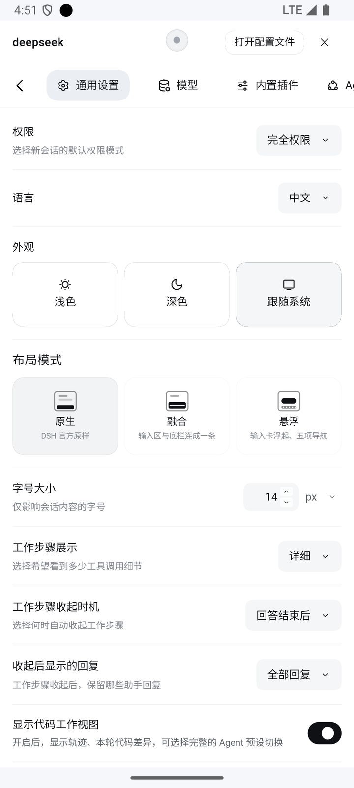

# 原生布局（default 预设）

> DSH 官方原样。插件只做两件事：把官方设置弹窗钉成**居中悬浮窗**；在输入行加一枚**附件（回形针）入口**——App 内（手机 / 平板、横竖屏、全屏 / 小窗）都出现，桌面端不出现（见文末）。三套布局之一，切换入口：**设置 → 通用设置 → 布局模式**。
> 截图为 v0.4.0 在 MuMu 模拟器（物理 720×1280，CSS 视口 400×684）的整机实拍，浅色主题。

其他预设：[融合](preset-classic.md) ｜ [悬浮](preset-v2.md) ｜ 回到 [README](../README.md)

---

## 界面总览

<table>
  <tr>
    <th align="center">主界面（官方布局）</th>
    <th align="center">设置悬浮窗（10vh 纵向留白）</th>
  </tr>
  <tr>
    <td align="center"></td>
    <td align="center"></td>
  </tr>
  <tr>
    <td valign="top">手机竖屏下<b>交还官方布局</b>：官方侧栏、官方居中 hero、官方输入卡，插件零干预。</td>
    <td valign="top">官方设置弹窗被钉成<b>居中悬浮窗</b>：左右等宽不掉边、上下各留约 10% 视口高；右上「打开配置文件」+ ✕。</td>
  </tr>
</table>

## 设置悬浮窗几何（多机型自适应）

几何量全部走 CSS 变量（定义在 `html[data-dshm-form="phone"]` 作用域），不写死 px：

| 变量 | 默认值 | 作用 |
|---|---|---|
| `--dshm-settings-gutter` | `clamp(12px, 3.4vw, 20px)` | 左右留白（左右逐字符相同 + `margin: 0 auto`，居中不掉边） |
| `--dshm-settings-vpad` | `clamp(min 24px, 10vh, max 120px)` | 上下各留约 10% 视口高；矮屏保底 24px、高屏封顶 120px |
| `--dshm-settings-maxw` | `480px` | 面板最大宽度（同时受 `100vw - 2×gutter - 2×safe-x` 钳制） |
| `--dshm-settings-safe-x` | `max(env(safe-area-inset-left), env(safe-area-inset-right))` | 挖孔屏 / 手势条安全区叠加 |

## 行为说明

- **纯官方布局**：原生预设不进入手机布局的任何改造（`mode=default`，样式全部收在 `data-dshm-mode="mobile"` 之外不生效）。**唯一例外**是下面的输入行附件入口。
- **设置页悬浮窗**：`settingsFrameMetrics` 纯函数计算四边 + `max-width`，经内联 `!important` 钉住任意官方变体；页签行、工具行与标题对齐。
- **切换保持打开**：从融合 / 悬浮切到原生时设置页**保持打开**并原地变悬浮窗形态；从原生切回则恢复全屏接管。
- **✕ / 系统返回**：关闭后正确消费历史栈条目，桌面返回不空转、不误关官方弹窗。

---

## 输入行附件入口（v0.4.6）

原生模式下，官方 composer 工具行左端多一枚**回形针按钮**，位置在官方 ⊕ 与权限 chip 之后、模型 chip 之前：

```
⊕  →  权限 chip  →  📎  →  模型 chip  →  发送
```

点它会在按钮**上方就近弹出**两项菜单：

| 菜单项 | 行为 |
|---|---|
| 选择图片 | 打开系统图片选择器（`accept="image/*"`，可多选） |
| 选择文件 | 打开系统文件选择器（不限类型，可多选） |

选完仍走官方链路：文件回流到官方隐藏 input，由 `intakeFiles` 负责校验（大小 / 数量 / 类型）、上传与缩略图，插件不重复提示。

**生效范围**（判据见 `quickPickVisible(preset, host, phone)`：原生预设 + 非桌面宿主，Android 壳内不看几何）：

| 形态 | 出现 |
|---|---|
| 手机竖屏（如 390×844） | ✅ |
| 手机横屏 / 自由小窗 / 分屏（任意方向） | ✅ |
| 平板（横屏 / 竖屏 / 全屏 / 分屏 / 小窗，如 1280×752） | ✅ 平板只跑原生预设，输入行只有 ⊕ 一枚，附件是高频入口，不再折叠进 ⊕ 的二级菜单 |
| 桌面端（Electron） | ❌ 宿主判定优先，注册阶段就跳过，DOM 里不留空节点 |
| 桌面浏览器（`web` 宿主 + 非手机竖屏几何） | ❌ 仍按手机几何兜，桌面浏览器不多出按钮 |

**交互细节**：

- 再点一次按钮、点菜单以外任何位置、按 Esc 都能收起菜单；
- 展开前先把输入框 `blur()`，避免菜单与软键盘同屏；
- 智能体运行中官方 `div.tools` 整块隐藏，按钮随之消失，不抢位置；
- 菜单样式取官方 token（`--dsw-specific-menu` / `--dsw-elevation-panel` / `--dsw-alias-border-l1`），浅深主题自动跟随。

**为什么不直接放两枚「图片」「文件」按钮**：输入行工具区本来就窄（400px 视口下可用约 376px），两枚 28px 圆钮相邻既挤又容易点错；单枚回形针 + 两项菜单把入口语义收敛成「附件」，与系统交互一致，横向只多占 36px。
