# 胶囊底栏（v2 预设 · 可选样式）

> v2 悬浮布局之上的**第二套底栏样式**：底栏浮起成圆角胶囊，顶部是悬浮卡片头，输入区合成一行。
> 入口：**设置 → 通用设置 → 布局模式 → 悬浮 → 底栏样式 → 胶囊**（默认仍是「透明底栏」，老外观逐像素不变）。

其他预设：[原生](preset-default.md) ｜ [融合](preset-classic.md) ｜ [v2 悬浮](preset-v2.md) ｜ 回到 [README](../README.md)

> 截图为 `Medium_Phone_API_35` 模拟器（物理 1080×2400，CSS 视口 457×962，时区 Asia/Shanghai）的整机实拍，浅色主题（深色单独一节）。
> 根属性：`html[data-dshm-mode="mobile"][data-dshm-preset="v2"][data-dshm-dock="capsule"]`。

---

## 界面总览

<table>
  <tr>
    <th align="center">会话页（展开）</th>
    <th align="center">收起态</th>
  </tr>
  <tr>
    <td align="center">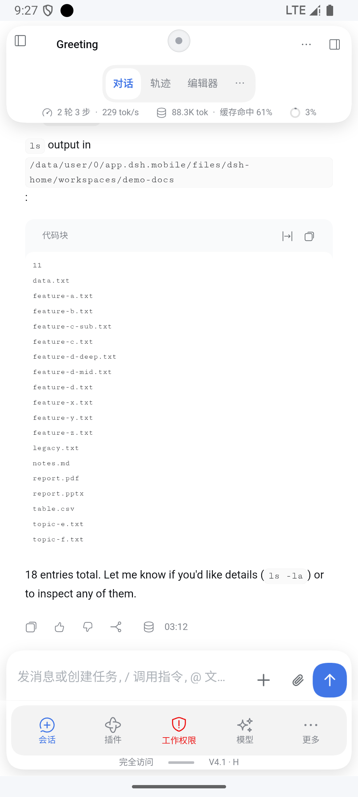</td>
    <td align="center">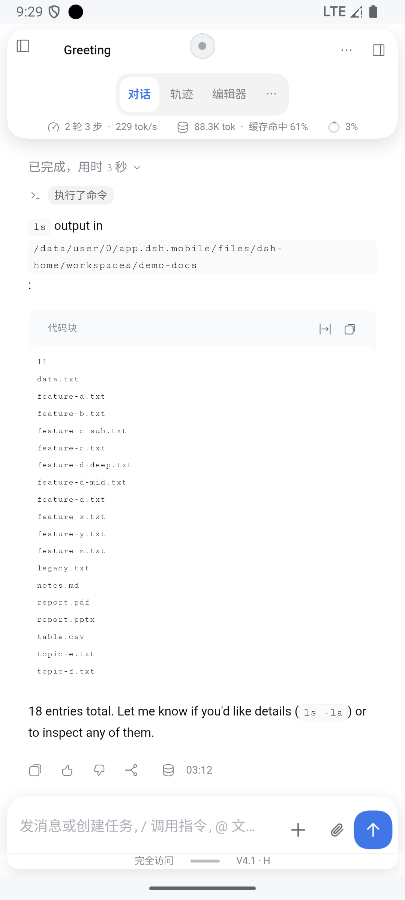</td>
  </tr>
  <tr>
    <td valign="top">顶部悬浮卡片头（标题行 / 居中分段控件 / 统计带）+ 一行输入区 + 灰槽五键底栏 + 脚注「实际权限 · 把手 · 实际模型」。</td>
    <td valign="top">点把手收起：底栏只剩脚注一行，页面让位量（<code>--dshm-v2-nav-total</code>）同步收缩，会话区顺势变高。</td>
  </tr>
</table>

## 顶部卡片头

<table>
  <tr>
    <th align="center">标题行 + 分段控件 + 统计带</th>
  </tr>
  <tr>
    <td align="center"></td>
  </tr>
  <tr>
    <td valign="top">
      三段各自独立：<b>标题行</b>（44px，左右 24px 内缩、按键与标题同中线）→ <b>页签带</b>（52px，官方页签行尺寸不变、仅透明化，自绘分段控件叠在预留带上）→ <b>统计带</b>（26px，透明底并入卡片）。
      分段控件高 48px，末尾保留「⋯」，点击按索引转发给官方页签。
    </td>
  </tr>
</table>

## 输入区一行

<table>
  <tr>
    <th align="center">输入卡（与五键槽等高）</th>
    <th align="center">键盘态</th>
  </tr>
  <tr>
    <td align="center"></td>
    <td align="center">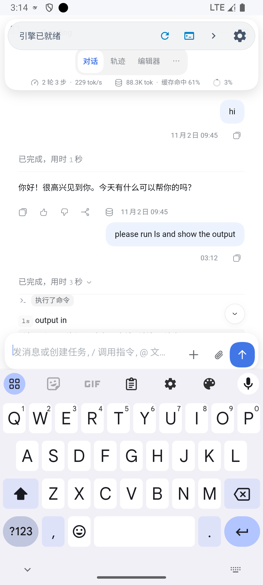</td>
  </tr>
  <tr>
    <td valign="top"><code>[输入框] ⊕ 回形针 发送</code> 合成一行：卡片 <code>min-height</code> 与下方导航槽同为 64px，动作按钮 44px、图标 24px。</td>
    <td valign="top">软键盘弹出时 <code>data-dshm-ime</code> 置位：底栏让位为 0、输入卡贴在键盘上沿，不出现白带。</td>
  </tr>
</table>

## 弹层

<table>
  <tr>
    <th align="center">工作权限</th>
    <th align="center">模型 / 推理等级</th>
    <th align="center">回形针（图片 / 文件）</th>
  </tr>
  <tr>
    <td align="center">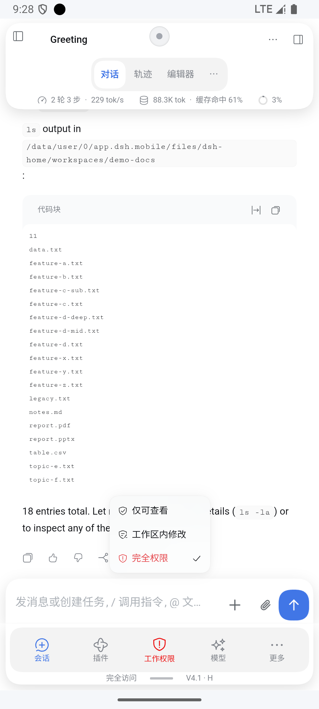</td>
    <td align="center">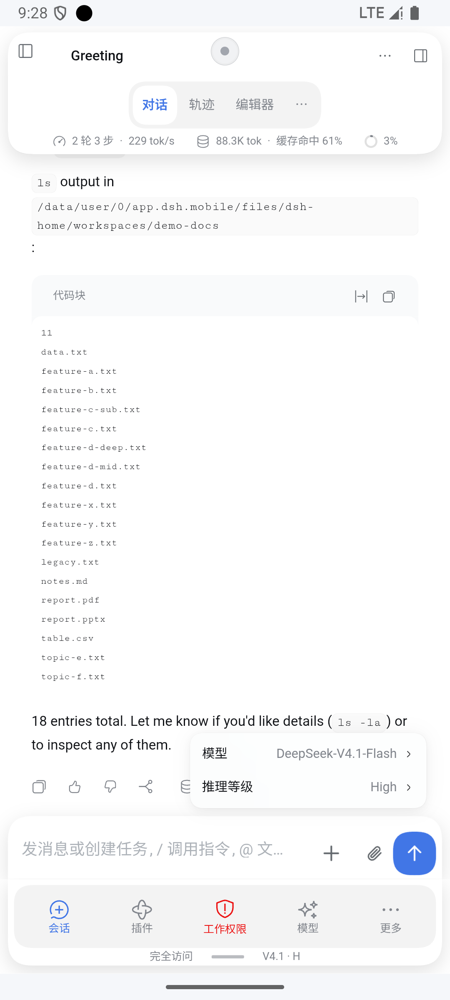</td>
    <td align="center">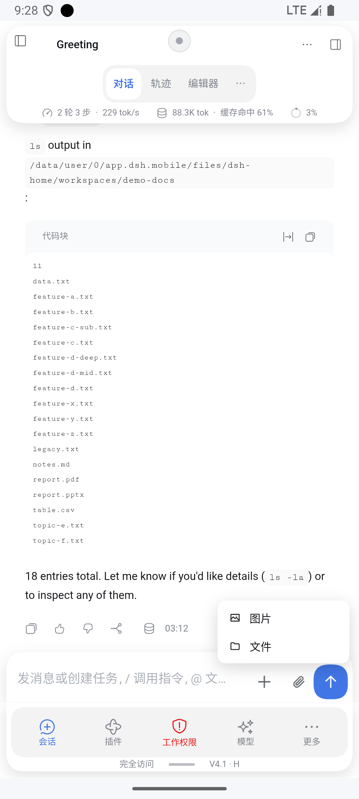</td>
  </tr>
  <tr>
    <td valign="top">三档带图标；当前档位（完全权限）整项标红。底栏「工作权限」的图标直接取自这份菜单。</td>
    <td valign="top">两行（模型 / 推理等级），子菜单即时展开；高度按内容，最长 <code>min(58vh, 22em)</code>。</td>
    <td valign="top">只两项；与权限菜单同款行高 36px、白面 14 圆角，以按钮为中心、两侧留 12px。</td>
  </tr>
</table>

<table>
  <tr>
    <th align="center">加号面板（sheet）</th>
  </tr>
  <tr>
    <td align="center">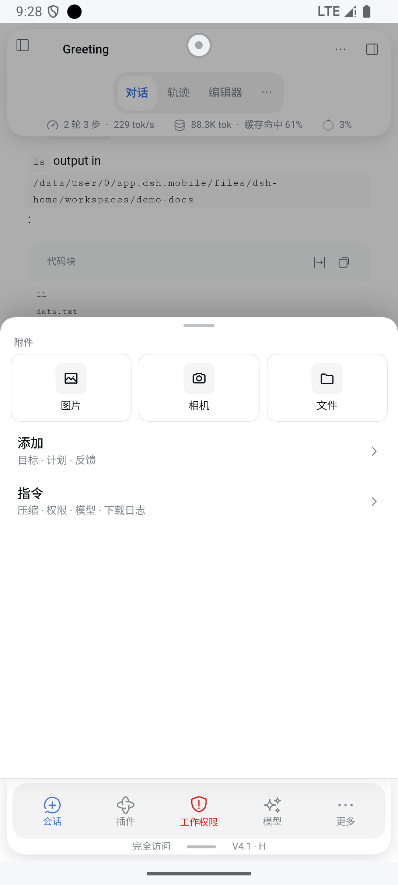</td>
  </tr>
  <tr>
    <td valign="top">附件（图片 / 相机 / 文件）+ 添加（目标 · 计划 · 反馈）+ 指令（压缩 · 权限 · 模型 · 下载日志）。面板与遮罩都停在底栏上沿，底栏保持可见可点。</td>
  </tr>
</table>

## 对话区

<table>
  <tr>
    <th align="center">居中日期分隔 + 工具调用 chip + 代码块卡片</th>
  </tr>
  <tr>
    <td align="center">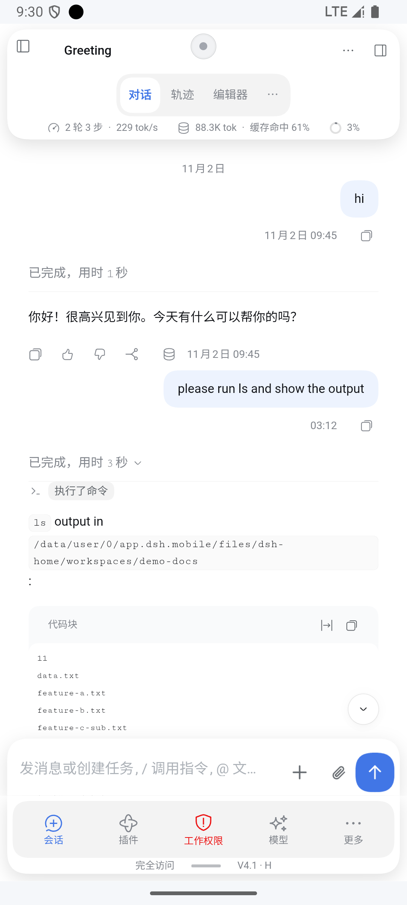</td>
  </tr>
  <tr>
    <td valign="top">
      「11月2日」居中显示（<code>::before</code> 画在当天第一条消息上方，不插入节点）；工具调用渲染成 <code>执行了命令</code> 小胶囊；代码块独立成卡片；操作行按钮统一 2em。
    </td>
  </tr>
</table>

## 换页与设置

<table>
  <tr>
    <th align="center">插件页</th>
    <th align="center">设置页</th>
  </tr>
  <tr>
    <td align="center">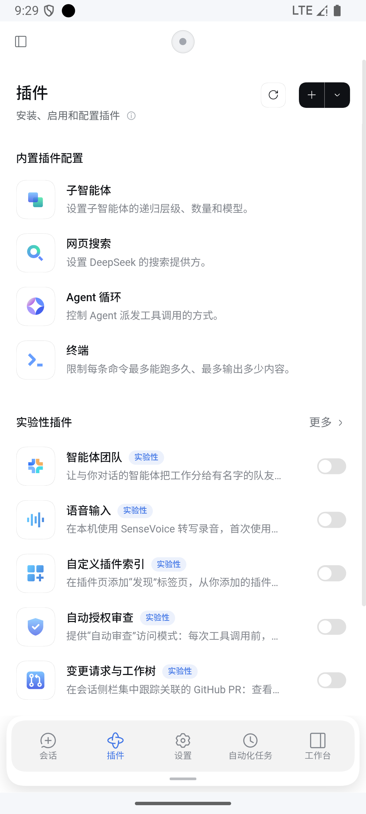</td>
    <td align="center">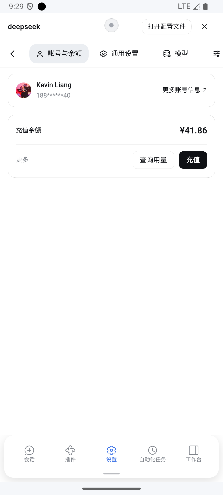</td>
  </tr>
  <tr>
    <td valign="top">换页后底栏仍五格：工作权限 / 模型两格由「更多」里的目的地补位，底栏不跳宽。</td>
    <td valign="top">设置页里底栏与设置白面同底（无灰槽）、保留胶囊阴影；脚注的权限 / 模型文案只在会话页出现，其余页只留把手。</td>
  </tr>
</table>

## 深色

<table>
  <tr>
    <th align="center">深色主题（设置 → 通用设置 → 外观 → 深色）</th>
  </tr>
  <tr>
    <td align="center">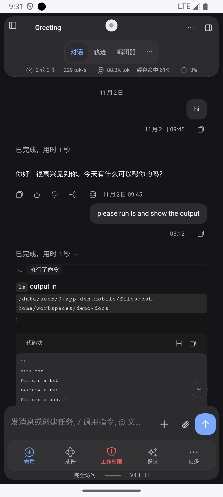</td>
  </tr>
  <tr>
    <td valign="top">卡片头、分段控件、代码块、输入卡、底栏全部跟随深色 token；正文在深色下字号 +1px。系统夜间模式不影响该壳，必须在 App 内切换外观。</td>
  </tr>
</table>

---

## 行为速查

| 交互 | 结果 |
|---|---|
| 点把手 | 收起 / 展开底栏；收起后让位量 = 把手行高 + 边距 |
| 点分段控件 | 切换官方页签（对话 / 轨迹 / 编辑器），末尾「⋯」转发官方更多 |
| 点 ⊕ | 打开加号面板（附件 / 添加 / 指令） |
| 点回形针 | 弹「图片 / 文件」两项，选择后走官方附件注入链路 |
| 点发送 | 转发官方发送按钮（空输入时保持官方禁用态） |
| 点工作权限 / 模型 | 弹层抬到「输入卡之上」，与输入卡、按键区零重叠 |
| 键盘弹出 | 底栏让位 0、输入卡贴键盘；收起键盘自动复原 |

## 实现要点（给维护者）

- **不搬官方结构**：输入区一行靠「官方工具行自身收成 0 高 + 自绘动作行」实现；任何改工具行**外层布局**的做法都会触发重渲染，把节点换成 16×87 的窄容器（详见 [技术说明 §3.18](technical-notes.md)）。
- **弹层用 `translate` 抬升**，不改 `bottom/left`：改布局位置会让官方子菜单按父菜单重算锚点，子菜单会一直停在 0 高度。
- **弹层目标高度读实测导航高度**，不要读 `--dshm-v2-nav-total`：该变量在弹层打开瞬间可能读到 0。
- **官方 TAB 行尺寸不变**，只 `opacity: 0` 隐藏；分段控件叠在卡片底部预留带上。
- **`em` 基准陷阱**：官方输入区这一行 `font-size` 是 13.33px，自绘按钮要显式写 `font-size: 16px`，否则 44px 的按钮只有 36.7px。

## 已知限制

1. 平板（短边 > 600）走原生布局，本样式完全不激活（已用 `Pixel_Tablet_API_35` 实测：`data-dshm-mode=null`、无胶囊节点）。
2. 官方页签行宽度由外部给定（769px 量级），无法用 CSS 居中，因此采用「透明化 + 自绘」而不是改造官方那一行。
3. 深色只能通过 App 内「外观」切换，系统夜间模式不生效。
